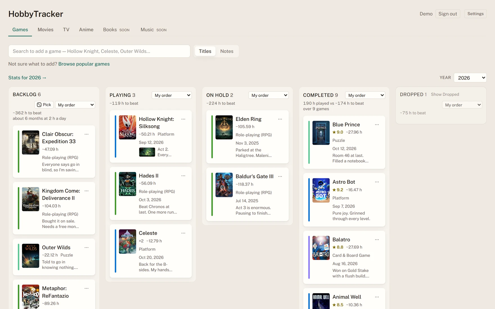
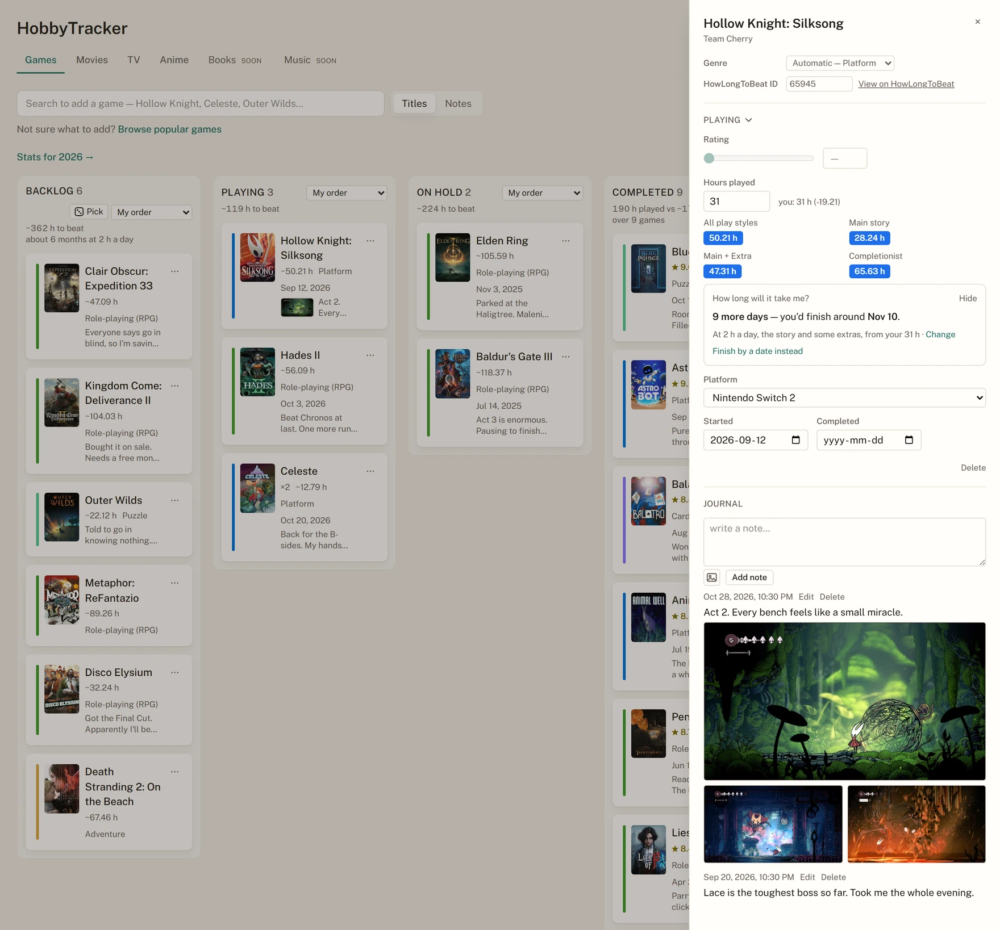
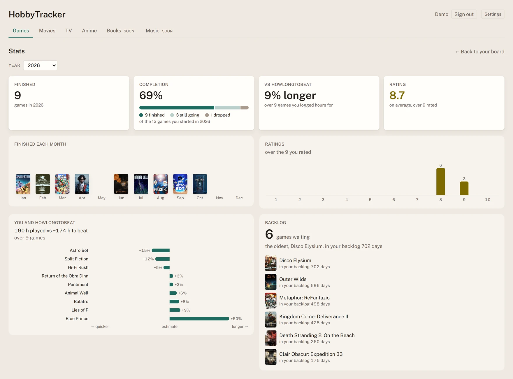
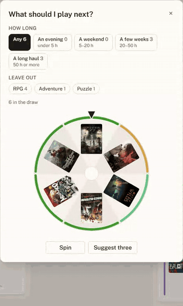
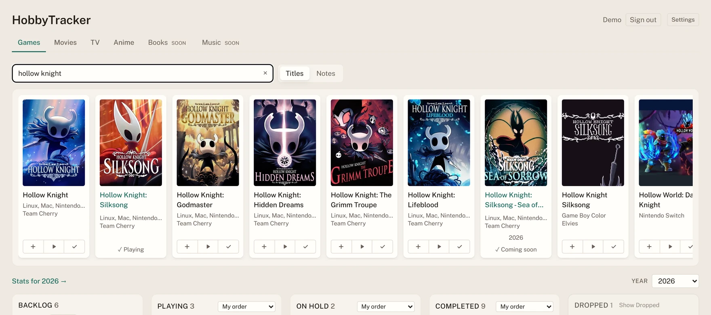
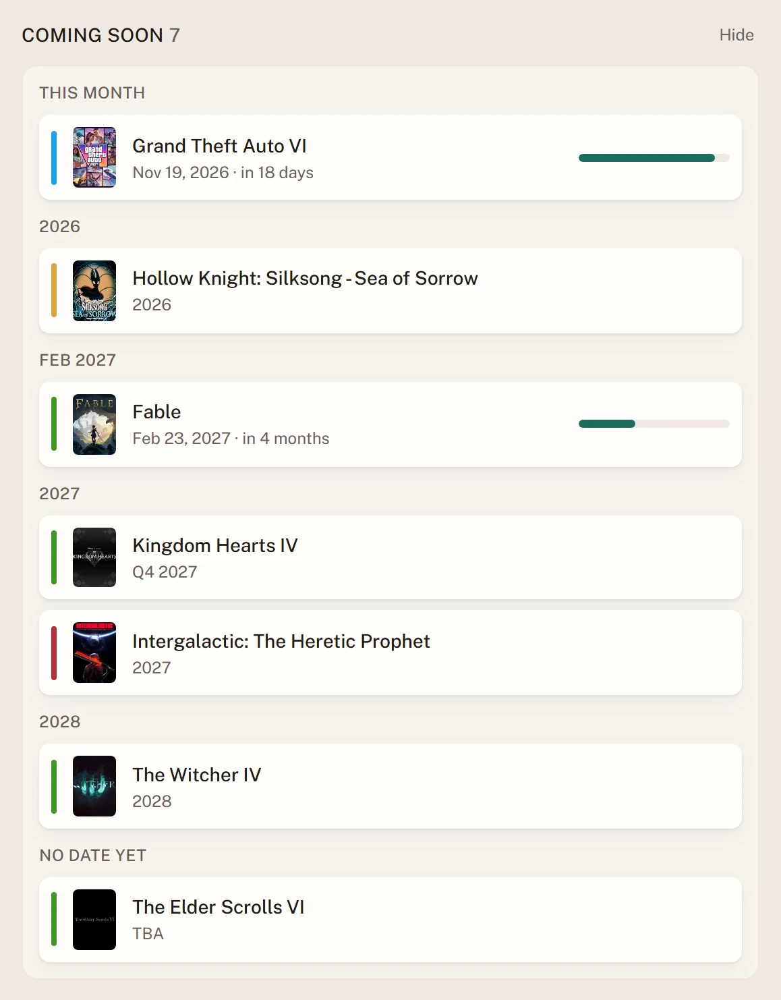
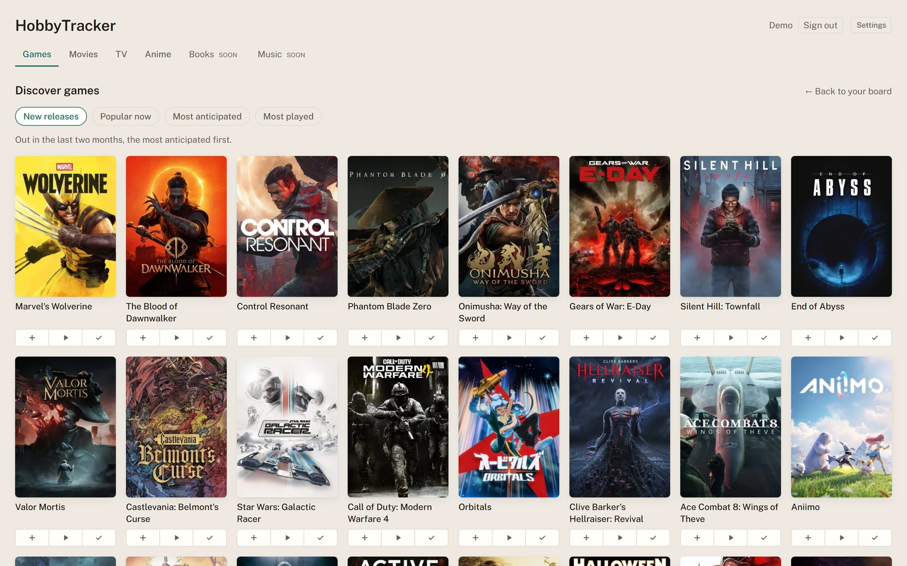
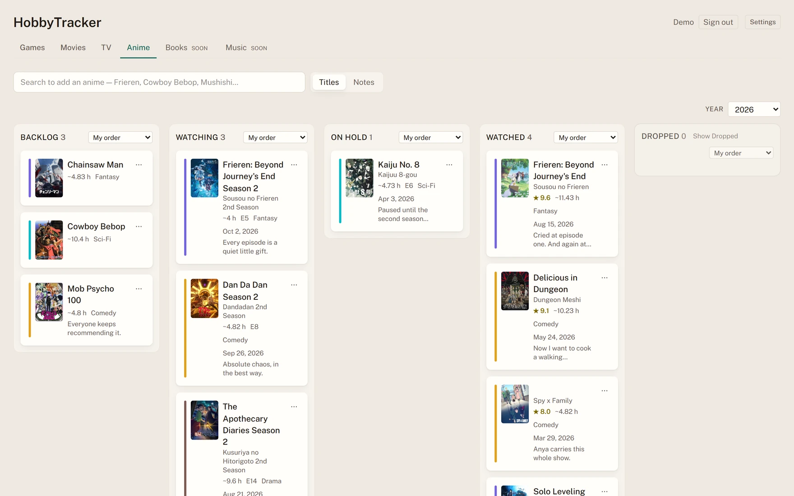
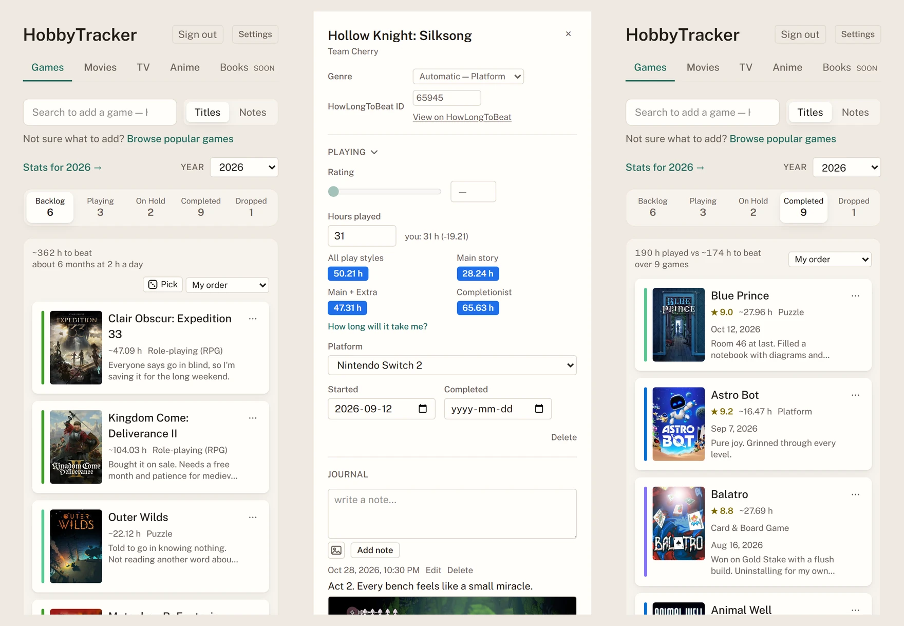

# HobbyTracker

A journal for the games, films, shows and anime you get through: a board for where each one is,
and a drawer for what you thought of it. Deployed and in use behind a sign-in.

[A tour](#a-tour) · [How it's built](#how-its-built) · [Running it](#running-it-locally) ·
[Design notes](docs/design-notes.md) · [API](docs/api.md) · [How it got here](docs/history.md)

<picture>
  <source media="(prefers-color-scheme: dark)" srcset="docs/shots/board-dark.webp">
  
</picture>

## A tour

A title moves between five columns, Backlog, Playing, On Hold, Completed and Dropped, by drag or
from its card's menu, and the server decides which dates a move stamps. On the games board each
column adds up how long its games take, and Completed sets your hours against HowLongToBeat's.
These screenshots are a demo account: the covers, dates and hours are real data from IGDB, TMDB,
MyAnimeList and HowLongToBeat, and the notes were written for them.

### The journal

Every title opens a journal over the board: your rating and dates, your hours beside
HowLongToBeat's four estimates and the day you'd finish at your own pace, dated notes with
pictures pasted in, and every earlier playthrough with its own notes. It saves as you type, so
there is no Save button.

<picture>
  <source media="(prefers-color-scheme: dark)" srcset="docs/shots/journal-dark.webp">
  
</picture>

### A year in numbers

What you finished, month by month; your hours against HowLongToBeat's, game by game; your
ratings, each point opening the games you gave it; how much of what you started you finished;
and how long each game has waited in the backlog. It counts every playthrough, so a year's
numbers stay put when a game is replayed.

<picture>
  <source media="(prefers-color-scheme: dark)" srcset="docs/shots/stats-dark.webp">
  
</picture>

### What should I play next?

<table>
<tr>
<td>
<picture>
  <source media="(prefers-color-scheme: dark)" srcset="docs/shots/wheel-dark.gif">
  
</picture>
</td>
<td>

*Pick*, in the backlog's header, spins a wheel of the backlog's covers once you've said how long
you want to play and which genres you're not in the mood for. Every game in the column has the
same chance, *Not this one* takes the one it landed on out of the draw, and *Start playing* moves
it to Playing as a drag would.

</td>
</tr>
</table>

### And the rest

<table>
<tr>
<td>
<picture>
  <source media="(prefers-color-scheme: dark)" srcset="docs/shots/search-dark.webp">
  
</picture>
<p><b>Adding a game.</b> Search sits above the board. Every result adds straight to Backlog,
Playing or Completed, dated the way a drag would date it, and one already on the board says
which column it's in.</p>
</td>
<td>
<picture>
  <source media="(prefers-color-scheme: dark)" srcset="docs/shots/calendar-dark.webp">
  
</picture>
<p><b>Coming soon.</b> Unreleased games wait in a calendar under the board, dated only as
precisely as the publisher said, and arrive in Backlog on release day with no job running.</p>
</td>
</tr>
<tr>
<td>
<picture>
  <source media="(prefers-color-scheme: dark)" srcset="docs/shots/discover-dark.webp">
  
</picture>
<p><b>Discover.</b> A wall of what's new and popular on IGDB, or like the games you rated
highest, for filling the board without knowing what to search for.</p>
</td>
<td>
<picture>
  <source media="(prefers-color-scheme: dark)" srcset="docs/shots/anime-dark.webp">
  
</picture>
<p><b>More than games.</b> Films, TV and anime have boards of their own and fields of their own:
the episode you're on, and both of an anime's titles.</p>
</td>
</tr>
<tr>
<td colspan="2">
<picture>
  <source media="(prefers-color-scheme: dark)" srcset="docs/shots/phones-dark.webp">
  
</picture>
<p><b>On a phone.</b> One column at a time under a switcher pinned to the top. A card is picked
up by holding it still, so a swipe scrolls, and the app installs to a home screen.</p>
</td>
</tr>
</table>

Also: searching your notes on every board, every word in any order, opening the journal at the
note it found; on the games board, a spreadsheet of everything on it and a read-only link to
share it, never with a note; eight themes; and deleting your account, which signs every other
device out at its next request.

## How it's built

ASP.NET Core 10 · EF Core 10 · PostgreSQL 17 · React 19 + TypeScript · Vite 8 · Tailwind v4 ·
TanStack Query · dnd-kit. IGDB, TMDB and MyAnimeList through their APIs, and HowLongToBeat by
scraping, behind a matcher that would rather say nothing than guess.

Six of the decisions that were actually decisions. All twenty, each with what it cost, are in
[docs/design-notes.md](docs/design-notes.md), and every route is in [docs/api.md](docs/api.md).

**Table-Per-Type over one `media` table.** Every title has a row in `media` whatever its hobby,
and a row in a games, films, shows or anime table beside it whose key is also its foreign key.
One table for everything would be mostly empty columns by the fourth hobby, and one table per
hobby would turn "everything I logged this year" into a `UNION`.

**Scoping is a parameter at every call site, not a query filter.** A filter would scope each read
invisibly, so a mistake would show up as an empty board, or a stranger's, rather than an error,
and nobody could review it where it happens. Every query that reads someone's data takes the user
by hand, and each second-user test was checked by taking its predicate away. The history of
column moves is the deliberate opposite: one interceptor writes it, because a recorder missing
from one write site loses that history for good, with nothing to raise an error.

**HowLongToBeat's matcher refuses rather than guesses.** The numerals have to agree outright
("Final Fantasy VII" scores about 0.97 against "VIII" on letters alone), and the winner has to
beat the runner-up by a margin, so the two *Resident Evil 4*s are never settled by a coin flip
that looks like a confident match. When it refuses, the journal takes a HowLongToBeat id by hand.

**IGDB's ranking can't tell a game from a fan game named after it.** Searching "Hollow Knight
Silksong" put a one-person Game Boy Color game above Team Cherry's, because its title is that
exact string. Results are re-ordered by how many people have played each game before how well the
title matches, and the two rules that were tried and lost are pinned by tests named after what
they got wrong.

**Pictures live in Postgres, their bytes in a table of their own.** In the database a deleted
note, title or account takes its pictures with it by cascade, and the nightly dump backs them up,
where a folder of files would need code for both. The bytes sit apart because every read that
carries a note brings its pictures: kept in the same rows, opening a journal would pull every
picture out of the database for an answer that sends none of them. A test reads the SQL of every
route that carries notes and finds the bytes untouched.

**A share link is read by nobody, so whose board it is gets said at every read.** The anonymous
controller holds three narrow interfaces and nothing that writes or asks who is signed in. Making
a visitor look like the owner would have been easier, and would have handed every write to
whoever had the link. A test proves on the SQL that no route a share reaches reads a note.

Written test-first throughout: the failing test, shown red, then the code. Where a rule exists to
prevent something, its test is checked by putting that thing back.

## Running it locally

Needs the .NET 10 SDK, Node and Docker, and an app at each provider: IGDB through a
[Twitch application](https://dev.twitch.tv/console/apps), a read access token from
[TMDB](https://www.themoviedb.org/settings/api), a client id from
[MyAnimeList](https://myanimelist.net/apiconfig), and Google and Discord sign-in apps with
`http://localhost:5173/api/auth/{provider}/callback` as the redirect URI.

```bash
docker compose up -d db

dotnet user-secrets set "Igdb:ClientId"             "..." --project backend/src/HobbyTracker.Api
dotnet user-secrets set "Igdb:ClientSecret"         "..." --project backend/src/HobbyTracker.Api
dotnet user-secrets set "Tmdb:AccessToken"          "..." --project backend/src/HobbyTracker.Api
dotnet user-secrets set "Mal:ClientId"              "..." --project backend/src/HobbyTracker.Api
dotnet user-secrets set "Auth:Google:ClientId"      "..." --project backend/src/HobbyTracker.Api
dotnet user-secrets set "Auth:Google:ClientSecret"  "..." --project backend/src/HobbyTracker.Api
dotnet user-secrets set "Auth:Discord:ClientId"     "..." --project backend/src/HobbyTracker.Api
dotnet user-secrets set "Auth:Discord:ClientSecret" "..." --project backend/src/HobbyTracker.Api

dotnet tool install --global dotnet-ef --version 10.0.11
dotnet ef database update --project backend/src/HobbyTracker.Api --startup-project backend/src/HobbyTracker.Api

dotnet run --project backend/src/HobbyTracker.Api    # http://localhost:5201
cd frontend && npm install && npm run dev            # http://localhost:5173
```

Then open **http://localhost:5173**, not the API's port: sign-in has to stay on one origin. Startup
fails on purpose, naming the setting, if any of those eight secrets is missing. **Start here** in
[CLAUDE.md](CLAUDE.md) has the rest, including a stand-in Google for when there is no app to hand.

## Running it in production

Two containers behind one origin: Caddy serves the built app and passes `/api` to the API.
`deploy/.env` is the whole of a deployment, and the setting that is not optional is
`PUBLIC_ORIGIN`, because behind anything that ends TLS the app would otherwise build its sign-in
redirects as `http://`. [docs/deploy.md](docs/deploy.md) is the runbook.

```bash
cp deploy/.env.example deploy/.env     # fill it in, then chmod 600
docker compose -f deploy/compose.yml up -d --build
```

**Anyone who can reach it can sign up.** Nobody reads anybody else's journal, but there is no
invite gate yet, so put an access policy in front of it or keep the address to yourself.

## Tests

```bash
dotnet test --solution backend/HobbyTracker.slnx    # backend, against a throwaway Postgres
cd frontend && npm test                             # frontend
cd frontend && npm run test:e2e                     # in a real browser
```

The backend runs against real Postgres in Testcontainers, because what is worth testing here is
Postgres's own: the partial unique index behind an idempotent search, the unique violation it
recovers from, array columns and check constraints. The end-to-end suite drives the real API on a
database of its own, with IGDB, TMDB, MyAnimeList, HowLongToBeat and the OAuth provider each
stood in for by a small server rather than a mock.

## Credits

Game data from [IGDB](https://www.igdb.com/). This product uses the TMDB API but is not endorsed
or certified by TMDB. Anime data from [MyAnimeList](https://myanimelist.net/).

Working in the repo? [CLAUDE.md](CLAUDE.md) is the brief, and it routes to one file per area under
[docs/](docs).
